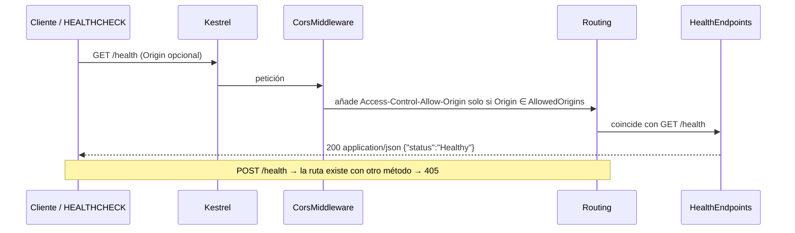

# Diseño: esqueleto-solucion

Fecha: 2026-10-10 · Fase: sdd-design · Base: `proposal.md` (incluida la Ronda 2), `exploration.md` (D1–D13) y las 4 especificaciones (27 requisitos, 53 escenarios; supuestos confirmados por el usuario).

Convención: **[VERIFICADO]** = comprobado por el orquestador o en `exploration.md` §2. **[SIN VERIFICAR]** = se confirma en apply y tiene respaldo (ver §14). No se fijan versiones de paquetes en este documento: cada versión se fija y se verifica en apply con `dotnet package search` / `dotnet add package`.

## 1. Enfoque técnico

Solución `net10.0` con `.sln` clásico, cuatro capas de Clean Architecture más un frontend WASM independiente. La regla de dependencias se aplica en tres niveles: (1) `ProjectReference` estrictos (un ciclo no compila), (2) una prueba por reflexión sobre los ensamblados compilados y (3) una prueba sobre los `.csproj` (Web sin referencias, `net10.0`, sin `Version`). `WorkedHours` es el único código de dominio y sirve de demostrador TDD. La API solo hace composición: `/health`, CORS validado al arrancar y OpenAPI exportado en el build. La tanda 2 añade el contenedor, la CI, los ADR y el README. Todo se diseña con el criterio KISS/YAGNI: Application e Infrastructure quedan **vacíos** (solo `.csproj`).

```
Domain  <──  Application  <──  Infrastructure  <──  Api (composition root)
   (sin dependencias)                                 ^ HTTP + CORS
                                                Web (blazorwasm, sin ProjectReference)
Tests: Domain.Tests→Domain · Application.Tests→Application · Api.IntegrationTests→Api
       ArchitectureTests→Domain, Application, Infrastructure, Api
```

## 2. Decisiones de arquitectura

| # | Decisión | Elección | Alternativas descartadas | Justificación |
|---|---|---|---|---|
| D-1 | Ejecutor de pruebas | **VSTest** (predeterminado del SDK 10), sin sección `test` en `global.json` | Microsoft.Testing.Platform (MTP) vía `global.json` | VSTest es el valor por defecto [VERIFICADO]; `--collect:"XPlat Code Coverage"` + `coverlet.collector` es el camino documentado; `coverlet.MTP` no está verificado; MTP trata "0 pruebas" como fallo, y `Application.Tests` empieza vacío. Respaldo: xUnit v2 con los mismos comandos. |
| D-2 | Formato de solución | `TimeTracker.sln` (`dotnet new sln --format sln`) | `.slnx` | No hay C# Dev Kit; compatibilidad máxima (proposal, Ronda 2). |
| D-3 | Propiedades comunes | `Directory.Build.props` raíz + `tests/Directory.Build.props` (importa la raíz y añade paquetes de prueba) | Repetir en cada `.csproj` | DRY: 4 proyectos de prueba comparten 4 paquetes y `OutputType=Exe`. |
| D-4 | `TargetFramework` | Declarado en cada `.csproj` (`net10.0`) | Centralizarlo en `Directory.Build.props` | Las plantillas ya lo escriben; es explícito y lo comprueba una prueba. |
| D-5 | Prueba de arquitectura | Reflexión (`Assembly.Load` + `GetReferencedAssemblies()`) + lectura XML de `.csproj` | NetArchTest; `dotnet list reference` solo manual | Sin dependencia nueva; la lectura XML detecta referencias que el compilador elimina por no usarse. |
| D-6 | `WorkedHours` | `readonly record struct` con constructor privado | `sealed record` (clase); `readonly struct` manual | `default(WorkedHours)` = 0 minutos, que es válido, así que el invariante se cumple siempre; hay igualdad por valor sin código; no hay `null`; no se asigna memoria en el heap. |
| D-7 | `/health` | Minimal API `MapGet("/health")` en la clase estática `HealthEndpoints`, que devuelve `TypedResults.Ok(HealthResponse)` | `AddHealthChecks`/`MapHealthChecks` | El escritor por defecto devuelve `text/plain`; un minimal API aparece solo en OpenAPI y produce el JSON exacto. `MapGroup` se reserva para los módulos de negocio (`/api/...`). |
| D-8 | Validación de configuración | `AddOptions<ApiCorsOptions>().BindConfiguration("Cors").ValidateOnStart()` + `IValidateOptions<ApiCorsOptions>` | DataAnnotations; validación manual antes de `Build()` | Las DataAnnotations no validan elementos de una lista; la validación previa a `Build()` rompería la exportación de OpenAPI y las sustituciones de `WebApplicationFactory`. |
| D-9 | Puerto | `ASPNETCORE_HTTP_PORTS` (estándar desde .NET 8; las imágenes `aspnet` lo fijan en `8080`) [SIN VERIFICAR, alta confianza] | `ASPNETCORE_URLS`; `--urls` | Es la variable que usan las imágenes oficiales. `ASPNETCORE_URLS` y `launchSettings.json` tienen prioridad: para comprobar el puerto, usar `dotnet run --no-launch-profile`. |
| D-10 | Imagen final y `HEALTHCHECK` | `aspnet:10.0-alpine` [imagen VERIFICADA] + `wget` de BusyBox | `aspnet:10.0` + `apt-get install curl`; modo `--healthcheck` en la propia API; `/dev/tcp` de bash | Las imágenes `aspnet` no traen curl/wget. Alpine trae `wget` sin paquetes extra, sin código propio y con una imagen menor. Respaldo: `aspnet:10.0` + curl. Consecuencia: sin ICU ni `tzdata` (ver riesgos R6). |
| D-11 | Exportación de OpenAPI | `Microsoft.Extensions.ApiDescription.Server` en el build hacia `docs/api/openapi.json`; `MapOpenApi()` solo en Development | Swagger UI; generarlo en una prueba | Fuente de verdad generada desde el código (AGENTS §8). Respaldo: una prueba que obtiene el documento con `WebApplicationFactory` y lo compara con el archivo. |
| D-12 | Umbrales de cobertura | `scripts/check-coverage.ps1` lee los `coverage.cobertura.xml` y exige 100 % de líneas y de ramas en `TimeTracker.Domain` | `coverlet.msbuild /p:Threshold`; ReportGenerator | No se mezclan `coverlet.msbuild` y `coverlet.collector`, ni se añade otra herramienta. Funciona igual en Windows y en GitHub Actions (`pwsh`). |
| D-13 | Application e Infrastructure | Proyectos vacíos (solo `.csproj`); sin `IClock` ni clases marcador | Clases de relleno, `AddApplication()` | YAGNI: compilan vacíos y la prueba de arquitectura los carga por nombre. |
| D-14 | `.editorconfig` | `dotnet new editorconfig` (generado) + un bloque final de ajustes justificados; **sin** `end_of_line` ni `charset` | Escribirlo a mano completo | Evita los falsos positivos de `dotnet format` por CRLF/BOM entre Windows y Linux. Nunca se desactiva `TreatWarningsAsErrors`. |

### D-1 Comandos exactos (VSTest)

```powershell
dotnet restore TimeTracker.sln
dotnet format TimeTracker.sln --verify-no-changes --no-restore
dotnet build TimeTracker.sln -c Release --no-restore -warnaserror
dotnet test TimeTracker.sln -c Release --no-build --collect:"XPlat Code Coverage" --results-directory TestResults
pwsh scripts/check-coverage.ps1 -ResultsDirectory TestResults -Package TimeTracker.Domain -MinimumPercent 100
```

Cada proyecto de pruebas deja un informe en `TestResults/<guid>/coverage.cobertura.xml`. `TimeTracker.Domain` aparece también, con poca cobertura, en los informes de otros proyectos. Por eso el script toma, para el paquete, el **mejor** `line-rate`/`branch-rate` entre los informes, que equivale a la cobertura que le da su proyecto de pruebas dedicado. Paquetes de prueba (en `tests/Directory.Build.props`): `Microsoft.NET.Test.Sdk`, `xunit.v3`, `xunit.runner.visualstudio`, `coverlet.collector`. Respaldo a v2: se sustituye `xunit.v3` por `xunit`, se quita `OutputType=Exe` y los comandos no cambian.

## 3. Estructura de archivos

| Archivo | Acción | Tanda | Propósito |
|---|---|---|---|
| `TimeTracker.sln` | Crear (CLI) | 1 | `dotnet new sln --format sln` + `dotnet sln add` de los 9 proyectos |
| `global.json` | Crear | 1 | `{"sdk":{"version":"10.0.302","rollForward":"latestFeature","allowPrerelease":false}}` |
| `Directory.Build.props` | Crear | 1 | `Nullable=enable`, `ImplicitUsings=enable`, `TreatWarningsAsErrors=true`, `AnalysisLevel=latest`, `EnforceCodeStyleInBuild=true`, `Deterministic=true` |
| `Directory.Packages.props` | Crear | 1 | `ManagePackageVersionsCentrally=true`; versiones fijas de todos los paquetes |
| `.editorconfig` | Crear (plantilla + ajustes) | 1 | Estilo; ajustes por sección (`[tests/**.cs]`) solo cuando aparezca el aviso, con un comentario del porqué |
| `.gitignore` | Crear (`dotnet new gitignore` + ajustes) | 1 | Añade `.env`, `TestResults/`, `artifacts/`, `coverage*.xml` (`bin/` y `obj/` ya vienen) |
| `.gitattributes` | Crear | 1 | `* text=auto`; binarios (`*.png`, `*.ico`, `*.woff2`) |
| `.dockerignore` | Crear | 1 | `**/bin/`, `**/obj/`, `.env`, `TestResults/`, `artifacts/`, `tests/`, `docs/`, `openspec/`, `.atl/`, `.vs/`, `.vscode/`, `src/TimeTracker.Web/` |
| `.env.example` | Crear | 1 | `Cors__AllowedOrigins__0=` (vacío) · `# ASPNETCORE_HTTP_PORTS=8080` (comentada: la imagen ya fija 8080; un valor vacío la anularía) · `# Ai__Provider=` / `# Ai__Model=` / `# Ai__Endpoint=` |
| `scripts/check-coverage.ps1` | Crear | 1 | Comprueba el umbral por paquete; termina con código ≠ 0 y un mensaje claro |
| `src/TimeTracker.Domain/{TimeTracker.Domain.csproj, WorkedHours.cs}` | Crear | 1 | Objeto de valor (TDD) |
| `src/TimeTracker.Application/TimeTracker.Application.csproj` | Crear | 1 | Vacío; `ProjectReference` → Domain |
| `src/TimeTracker.Infrastructure/TimeTracker.Infrastructure.csproj` | Crear | 1 | Vacío; `ProjectReference` → Application |
| `src/TimeTracker.Api/` (`dotnet new web`) | Crear | 1 | `Program.cs`, `Health/HealthEndpoints.cs`, `Health/HealthResponse.cs`, `Configuration/ApiCorsOptions.cs`, `Configuration/ApiCorsOptionsValidator.cs`, `Configuration/CorsServiceCollectionExtensions.cs`; `appsettings*.json` de la plantilla (sin CORS) |
| `src/TimeTracker.Web/` (`dotnet new blazorwasm`) | Crear (plantilla) | 1 | Sin PWA ni autenticación; único cambio: las `Version` de los `PackageReference` pasan a `Directory.Packages.props` (exigido por CPM, NU1008) |
| `tests/Directory.Build.props` | Crear | 1 | Importa la raíz; `OutputType=Exe`, `IsPackable=false`, paquetes de prueba, `<Using Include="Xunit" />` |
| `tests/TimeTracker.Domain.Tests/{csproj, WorkedHoursTests.cs}` | Crear | 1 | Pruebas TDD |
| `tests/TimeTracker.Application.Tests/*.csproj` | Crear | 1 | Sin pruebas todavía (VSTest termina en 0, ver V3) |
| `tests/TimeTracker.Api.IntegrationTests/{csproj, ApiFactory.cs, HealthEndpointTests.cs, StartupConfigurationTests.cs, CorsPolicyTests.cs}` | Crear | 1 | `WebApplicationFactory<Program>` con `UseSetting` |
| `tests/TimeTracker.ArchitectureTests/{csproj, RepositoryRoot.cs, DependencyRuleTests.cs, RepositoryConventionsTests.cs, OpenApiContractTests.cs}` | Crear | 1 | Reglas estructurales sobre ensamblados y archivos del repositorio |
| `docs/api/openapi.json` | Generado | 1 | Lo produce el build de Api; no se edita a mano |
| `Dockerfile`, `docker-compose.yml` | Crear | 2 | §8 |
| `.github/workflows/ci.yml` | Crear | 2 | §9 |
| `docs/adr/0001…0007-*.md` | Crear | 2 | §10 |
| `README.md` | Crear | 2 | Descripción, pila, compilar/probar/ejecutar, estructura |
| `openspec/config.yaml` | Modificar | 2 | Rellena `test_command`, `build_command` y la cobertura con los comandos de D-1; antes se guarda una copia (`config.yaml.bak`) para la reversión |

## 4. Prueba de arquitectura (D-5)

`RepositoryRoot` resuelve la raíz a partir de un `AssemblyMetadata("RepositoryRoot", "$(MSBuildThisFileDirectory)../../")` que se declara en el `.csproj`, sin recorrer carpetas.

| Prueba | Regla |
|---|---|
| `DependencyRuleTests.ProductionAssembly_ReferencesOnlyAllowedAssemblies` (Theory) | De los ensamblados `TimeTracker.*` referenciados: Domain → ∅; Application → {Domain}; Infrastructure → {Application, Domain}; Api → {Application, Infrastructure, Domain}. Se permiten referencias hacia dentro; el mensaje de fallo lista cada referencia ilegal. |
| `DependencyRuleTests.Domain_ReferencesOnlyBaseFramework` | Todas las referencias de Domain empiezan por `System` (marco base). |
| `RepositoryConventionsTests.Web_HasNoProjectReferences` | `src/TimeTracker.Web/*.csproj` no contiene `ProjectReference`. |
| `RepositoryConventionsTests.AllProjects_TargetNet10` | Los 9 `.csproj` contienen `TargetFramework` = `net10.0`. |
| `RepositoryConventionsTests.PackageReferences_DoNotDeclareVersion` | Ningún `PackageReference` tiene atributo `Version`. |

Los ensamblados se cargan con `Assembly.Load("TimeTracker.X")`: están en el `deps.json` gracias a `ProjectReference`, aunque no se use ningún tipo suyo [SIN VERIFICAR, V15].

**Hallazgo clave:** toda referencia ilegal entre las 4 capas forma un **ciclo** y falla ya en el build. Además, el compilador **omite las referencias que no se usan**. Por eso la demostración única de que la prueba de reflexión falla (en apply, sin dejar rastro) es esta:
1. Se añade temporalmente a Domain `<FrameworkReference Include="Microsoft.AspNetCore.App" />` y un archivo `IllegalReferenceProbe.cs` que usa `typeof(Microsoft.Extensions.Logging.ILogger)`. No requiere descarga: el paquete de destino viene con el SDK.
2. `dotnet test tests/TimeTracker.ArchitectureTests` → **rojo**, con la referencia ilegal en el mensaje. La salida se guarda como evidencia en `tasks.md`.
3. Se eliminan las dos cosas y la prueba vuelve a verde.

La comprobación de ciclos (Domain → Application) y la de avisos como errores (una variable local sin usar en Domain) se demuestran igual: cambio temporal, build en rojo, reversión y build en verde.

## 5. Interfaces y contratos

```csharp
// src/TimeTracker.Domain/WorkedHours.cs
public readonly record struct WorkedHours
{
    private WorkedHours(int minutes) => Minutes = minutes;
    public int Minutes { get; }                       // sin init: `with` no puede saltarse la validación
    public static WorkedHours FromMinutes(int minutes)
    {
        ArgumentOutOfRangeException.ThrowIfNegative(minutes);   // ParamName = "minutes"
        return new WorkedHours(minutes);
    }
    public static WorkedHours operator +(WorkedHours left, WorkedHours right)
        => new(checked(left.Minutes + right.Minutes));          // OverflowException, nunca envuelve
}
```

El `ToString()` que genera el record no es "formato de texto" de negocio y no se prueba. Si el analizador CA2225 exige un alternativo con nombre, se añade `Add(left, right)` con su prueba, en lugar de suprimir la regla.

```csharp
// src/TimeTracker.Api/Program.cs (estructura)
var builder = WebApplication.CreateBuilder(args);
builder.WebHost.ConfigureKestrel(o => o.AddServerHeader = false);
builder.Services.AddRestrictiveCors();      // options + validador + ValidateOnStart + política por defecto
builder.Services.AddOpenApi();
var app = builder.Build();
app.UseCors();
if (app.Environment.IsDevelopment()) app.MapOpenApi();
app.MapHealthEndpoints();
app.Run();
// public partial class Program; → solo si .NET 10 no lo genera (V7)
```

- `ApiCorsOptions { const string SectionName = "Cors"; IReadOnlyList<string> AllowedOrigins { get; set; } = []; }`.
- `ApiCorsOptionsValidator` falla si la lista es nula o vacía, o si algún elemento está en blanco, vale `*`, no es una URI absoluta, su esquema no es `http`/`https`, tiene `AbsolutePath != "/"`, consulta, fragmento o datos de usuario, o termina en `/`. Mensajes en español que **nombran la clave con su índice** (`Cors:AllowedOrigins:0`) y la razón, y **nunca repiten el valor**.
- La política CORS se configura con `AddOptions<CorsOptions>().Configure<IOptions<ApiCorsOptions>>(...)`, que hace `WithOrigins(...).AllowAnyHeader().AllowAnyMethod()`, sin credenciales.
- `HealthResponse(string Status)` se serializa en camelCase y produce `{"status":"Healthy"}`. El `Content-Type` real es `application/json; charset=utf-8`; las pruebas comparan el *media type*.
- `Api.csproj` declara: `Microsoft.AspNetCore.OpenApi`; `Microsoft.Extensions.ApiDescription.Server` (`PrivateAssets=all`); `OpenApiDocumentsDirectory=$(MSBuildProjectDirectory)/../../docs/api`; `OpenApiGenerateDocumentsOptions=--file-name openapi` [SIN VERIFICAR, V6].
- Cambio futuro: cuando llegue la autenticación, `/health` necesitará `.AllowAnonymous()`.

## 6. Flujo de datos y secuencias

```mermaid
sequenceDiagram
  participant Op as Operador / contenedor
  participant P as Program.cs
  participant H as Host
  participant V as ApiCorsOptionsValidator
  participant K as Kestrel
  Op->>P: dotnet TimeTracker.Api.dll (env Cors__AllowedOrigins__N, ASPNETCORE_HTTP_PORTS)
  P->>H: CreateBuilder (appsettings + variables de entorno)
  P->>H: AddRestrictiveCors, AddOpenApi, Build()
  P->>H: Run() → StartAsync
  H->>V: ValidateOnStart → Validate(ApiCorsOptions)
  alt configuración válida
    V-->>H: Success
    H->>K: escucha en http://+:PORT
  else inválida o ausente
    V-->>H: Fail("Cors:AllowedOrigins…: razón")
    H-->>P: OptionsValidationException (antes de iniciar Kestrel)
    P-->>Op: el proceso termina con código ≠ 0; ningún puerto abierto; sin valores en el mensaje
  end
```



## 7. Web (blazorwasm)

Es la plantilla sin cambios, salvo que las versiones pasan a CPM. Ejecución local:

```powershell
dotnet run --project src/TimeTracker.Web
$env:Cors__AllowedOrigins__0 = "<origen de Web según su launchSettings>"
dotnet run --project src/TimeTracker.Api
```

La URL base de la API (`ApiBaseUrl` en `wwwroot/appsettings.json` + `HttpClient`) queda **fuera de alcance**; solo se documenta en el README y en el ADR 0005. Si la plantilla genera avisos con `-warnaserror`, se ajusta la regla concreta en `.editorconfig` con un comentario. Nunca se cambia `TreatWarningsAsErrors` y los archivos de la plantilla no se editan.

## 8. Docker (tanda 2)

**`Dockerfile`**
- Etapa `build` con `mcr.microsoft.com/dotnet/sdk:10.0`: copia `global.json`, los `*.props`, `.editorconfig` y los `.csproj` de Domain, Application, Infrastructure y Api, y ejecuta `dotnet restore src/TimeTracker.Api/...`. Después copia `src/` y ejecuta `dotnet publish -c Release -o /app/publish --no-restore -p:UseAppHost=false -p:OpenApiGenerateDocuments=false`.
- Etapa `final` con `mcr.microsoft.com/dotnet/aspnet:10.0-alpine`:
  - `ENV ASPNETCORE_HTTP_PORTS=8080`
  - `EXPOSE 8080` (solo documenta el puerto)
  - `COPY --from=build`
  - `USER $APP_UID` [SIN VERIFICAR, V9]
  - `HEALTHCHECK --interval=30s --timeout=3s --start-period=15s --retries=3 CMD wget -q -O /dev/null "http://127.0.0.1:${ASPNETCORE_HTTP_PORTS:-8080}/health" || exit 1` (en forma shell, para expandir la variable; admite un solo puerto)
  - `ENTRYPOINT ["dotnet","TimeTracker.Api.dll"]`

**`docker-compose.yml`**
- Un único servicio, `api`, con `build: .`, `image: timetracker-api:local`, `env_file: .env` (obligatorio: el README indica copiar `.env.example`) y `ports: ["8080:8080"]`.
- Un `Cors__AllowedOrigins__0` vacío hace que el arranque falle rápido, que es el comportamiento buscado.

## 9. CI (tanda 2)

`.github/workflows/ci.yml` se dispara en `push` a `main` y en `pull_request`, y tiene un único job en `ubuntu-latest`. Pasos, en orden:
1. checkout
2. `actions/setup-dotnet` con `global-json-file: global.json`
3. restore
4. format `--verify-no-changes`
5. build `-warnaserror`
6. test con cobertura (comandos de D-1)
7. `check-coverage.ps1` (`pwsh`)
8. auditoría: `dotnet list TimeTracker.sln package --vulnerable --include-transitive`, que falla si la salida informa de paquetes vulnerables, porque el comando termina en 0 aunque los encuentre (V13)
9. `dotnet publish src/TimeTracker.Api -c Release --no-build -o artifacts/api`
10. `docker build -t timetracker-api:ci .`, **sin push**

Las versiones de las acciones se fijan en apply (V14). Reproducción local: los mismos comandos en PowerShell (el paso 8 se revisa a ojo). La validez del YAML solo se confirma en el primer push (R4).

## 10. ADR (se redactan en apply)

| Archivo | Decisión | Alternativas | Consecuencias |
|---|---|---|---|
| `0001-formato-de-adr.md` | Formato MADR reducido: Estado, Fecha, Contexto, Decisión, Consecuencias, Alternativas; los ADR no se reescriben, se sustituyen | Sin ADR; MADR completo | Trazabilidad con poco coste |
| `0002-net10.md` | net10.0 (LTS hasta 2028-11-14), SDK 10.0.302 con `latestFeature` | net8.0 (soporte hasta 2026-11-10); multi-target | Requiere SDK 10 en la máquina y en CI |
| `0003-monolito-modular-y-regla-de-dependencias.md` | 4 capas, `ProjectReference` + prueba por reflexión/XML, `.sln` clásico | NetArchTest; `.slnx`; microservicios | Hay que mantener la tabla de la prueba al añadir proyectos |
| `0004-minimal-apis-y-openapi.md` | Minimal APIs con `*Endpoints` estáticos (`MapGroup` por módulo), OpenAPI exportado a `docs/api/openapi.json` | Controladores; Swagger UI | El contrato se versiona y cambia con cada endpoint |
| `0005-frontend-wasm-y-cors.md` | WASM standalone, CORS restrictivo; servir el WASM desde la API se decide en el cambio de despliegue | Hosted (sin soporte en .NET 10); servirlo ya desde la API | Dos orígenes en desarrollo |
| `0006-pila-de-pruebas.md` | xUnit v3 + VSTest + coverlet.collector (Cobertura), script de umbrales, respaldo a v2 | MTP; coverlet.msbuild; NetArchTest | Sin ejecutor nuevo; el umbral se aplica con un script |
| `0007-configuracion-y-validacion-al-arrancar.md` | Variables de entorno, `ValidateOnStart` + `IValidateOptions`, `ASPNETCORE_HTTP_PORTS`, HTTP dentro del contenedor (TLS en el ingreso, se decide en el despliegue) | DataAnnotations; `ASPNETCORE_URLS`; HTTPS en Kestrel | Falla rápido; HTTPS queda diferido y explícito |

## 11. Estrategia de pruebas y trazabilidad

Prefijos: SA = solution-architecture, AH = api-health, SC = startup-configuration, WH = worked-hours. "Manual" significa que se verifica una vez y la evidencia queda en `tasks.md` / `verify-report.md`.

| Requisito | Proyecto / prueba o verificación |
|---|---|
| SA Estructura | `AllProjects_TargetNet10`; manual: `dotnet sln TimeTracker.sln list` (9) y `Test-Path TimeTracker.slnx` = False |
| SA Referencias | `Web_HasNoProjectReferences`; manual: `dotnet list <p> reference` ×5; ciclo Domain→Application (build en rojo, una vez) |
| SA Prueba de arquitectura | `ProductionAssembly_ReferencesOnlyAllowedAssemblies`, `Domain_ReferencesOnlyBaseFramework`; demostración del §4 |
| SA CPM y analizadores | `PackageReferences_DoNotDeclareVersion`; manual: variable sin usar en Domain → build en rojo |
| SA Puerta de calidad | Comandos de D-1 (build/test/format en 0) |
| SA Cobertura | `dotnet test --collect` + `check-coverage.ps1` (Domain: líneas y ramas = 1) |
| SA Archivos raíz | Manual: `Get-ChildItem -Force`; `Select-String '^\.env$' .gitignore, .dockerignore` |
| SA Docker | Manual: `docker build`, `docker inspect` (User, Healthcheck), `docker run -e Cors__AllowedOrigins__0=…`, `docker history` |
| SA Compose | Manual: `docker compose config --services` = `api` |
| SA CI | Revisión del YAML + reproducción local de los pasos |
| SA ADR/README | Manual: 7 archivos con 4 secciones; seguir el README |
| AH Respuesta | `HealthEndpointTests.Get_ReturnsOkWithHealthyJson`, `Post_ReturnsMethodNotAllowed` |
| AH Sin información sensible | `Get_BodyHasOnlyStatusProperty`, `Get_HeadersDoNotExposeMachineNameOrConfiguration` |
| AH OpenAPI | `OpenApiContractTests.ExportedDocument_ContainsHealthGet200`; manual: endpoint temporal → build → aparece → se retira |
| AH Prueba de integración | `Get_ReturnsOkWithHealthyJson`; regresión demostrada una vez cambiando el cuerpo (rojo) |
| SC Entorno | `StartupConfigurationTests.Startup_WithValidOrigin_BindsTypedOptions` (`UseSetting`); manual: `docker run -e` / `dotnet run --no-launch-profile`; revisión de `appsettings*.json` |
| SC ValidateOnStart | `Startup_WithoutAllowedOrigins_FailsNamingKey`; `Startup_WithInvalidAllowedOrigins_Fails` (Theory: `""`) |
| SC CORS | `Startup_WithInvalidAllowedOrigins_Fails` (`*`, `app.example.test/ruta`, `" "`, `ftp://…`, `https://a.test/ruta`, `https://a.test/`); `CorsPolicyTests.OnlyConfiguredOrigin_ReceivesAllowOriginHeader` |
| SC Errores sin secretos | Las pruebas anteriores comprueban que el mensaje contiene `Cors:AllowedOrigins` y **no** contiene el valor inválido |
| SC `.env.example` | Manual: comparación con las claves consumidas; `Select-String '^Ai__' .env.example` sin resultados |
| SC Puerto | Manual: `$env:ASPNETCORE_HTTP_PORTS=8081; dotnet run --no-launch-profile --project src/TimeTracker.Api` → `/health` responde 200 |
| WH 1–5 | `WorkedHoursTests` (orden TDD abajo) |
| WH 6 | `Domain_ReferencesOnlyBaseFramework` + `check-coverage.ps1` + orden registrado en `tasks.md` |

**Orden TDD de `WorkedHours`:**
1. `FromMinutes_WithPositiveValue_ExposesMinutes` (90): rojo de compilación → verde con un `readonly struct` mínimo.
2. `FromMinutes_WithNegativeValue_Throws` (Theory `-1`, `int.MinValue`, `ParamName == "minutes"`): rojo → `ThrowIfNegative`.
3. `FromMinutes_WithZero_IsValid`: verde a la primera (prueba de borde). Su rojo se demuestra con una mutación temporal (`ThrowIfNegativeOrZero`).
4. `Equals_SameMinutes_AreEqualWithSameHash` (con `==`): rojo de compilación (un struct no tiene `==`) → verde al convertirlo en `record struct`.
5. `Equals_DifferentMinutes_AreNotEqual`: pasa a la primera (pertenece al mismo contrato que la prueba 4).
6. `Add_TwoValues_ReturnsExactSumAndKeepsOperands`: rojo de compilación → `operator +` sin `checked`.
7. `Add_BeyondIntMaxValue_ThrowsOverflow`: rojo (sin `checked`, el resultado se envuelve) → `checked`.
8. `Add_WithZero_IsNeutral` y `Add_UpToIntMaxValue_ReturnsIntMaxValue`: pruebas de borde, verde a la primera.
9. Refactor: cuerpos de expresión y nombres; la suite sigue en verde.

**Umbrales por nivel:**

| Nivel | Umbral | Cómo se aplica |
|---|---|---|
| Domain | 100 % de líneas y ramas (DEBE) | `check-coverage.ps1` en local y en CI |
| Application | 80 % (DEBERÍA) | Sin código en este cambio; el script se invoca para Application cuando exista código |
| Infrastructure y Api | Sin umbral | Solo pruebas de integración |

## 12. Matriz de amenazas

| Frontera | Aplicabilidad |
|---|---|
| Rutas tipo documentación | N/A: no se clasifican ni ejecutan archivos por su ruta. |
| Selección de repositorio Git | N/A: no hay comandos Git (restricción del usuario); la CI solo hace checkout. |
| Estado de commit | N/A: no se automatizan commits. |
| Estado de push | N/A: la imagen no se publica (sin push); no se automatiza `git push`. |
| Comandos de PR | N/A: no hay automatización de PR. |

El `HEALTHCHECK` y el script de cobertura usan argumentos fijos, sin datos externos. No se definen pruebas RED adicionales.

## 13. Implementación por tandas y previsión de líneas (escritas a mano)

| Grupo | Tanda 1 | Tanda 2 |
|---|---|---|
| Archivos raíz (props, `global.json`, ajustes de ignore/editorconfig, `.env.example`) | 90–110 | — |
| `src` (`.csproj`, `WorkedHours`, Api: Program, Health, Configuration) | 170–210 | — |
| `tests` (props, `.csproj`, WorkedHours ~70, Api ~150, Architecture ~110) | 340–400 | — |
| `scripts/check-coverage.ps1` | 25–35 | — |
| `Dockerfile` + compose | — | 35–45 |
| `ci.yml` | — | 50–65 |
| ADR ×7 | — | 180–230 |
| `README.md` + `config.yaml` | — | 100–130 |
| **Total** | **≈ 625–755** | **≈ 365–470** |

El total es de unas **990–1225 líneas**, muy por encima de las 350–550 de la propuesta, que no contaba las pruebas de integración y de convenciones. No se incluyen las plantillas generadas (`blazorwasm`, `web`, gitignore, editorconfig) ni `openapi.json`. El ~40 % de la tanda 2 es prosa (ADR/README).
- 400-line budget risk: High
- Decision needed before apply: Yes (confirmar `size:exception`)
- Chained PRs recommended: No (estrategia `single-pr` sin repositorio; las tandas son los puntos de control)

Orden dentro de la tanda 1:
1. Archivos raíz y solución
2. Domain + Domain.Tests (TDD)
3. Proyectos vacíos
4. Api + IntegrationTests (cada prueba en rojo primero)
5. ArchitectureTests y sus demostraciones
6. Web
7. Cobertura y format
8. Punto de control: puerta de calidad completa

## 14. Riesgos, puntos abiertos y validaciones pendientes

**Riesgos**
- R1: xUnit v3 + VSTest + Coverlet no está probado de extremo a extremo. Respaldo: v2.
- R2: avisos de las plantillas o de los analizadores con `-warnaserror`.
- R3: el informe de cobertura de los miembros sintetizados del record puede no llegar a 1. Respaldo: `tests/coverage.runsettings` con `ExcludeByAttribute=CompilerGeneratedAttribute`, que se pasa con `--settings`.
- R4: la CI no se habrá ejecutado hasta que exista un remoto.
- R5: la exportación de OpenAPI en el build no está probada.
- R6: Alpine no trae ICU ni `tzdata`. El cambio de fichajes, si usa zonas horarias, tendrá que añadir `tzdata` o volver a la imagen Debian.
- R7: las pruebas de arranque dependen de que la máquina no tenga definida `Cors__AllowedOrigins__*`.
- R8: el tamaño del cambio (§13).
- R9: las imágenes se referencian por etiqueta, no por digest. Fijarlas por digest queda para el cambio de Dependabot.

**Puntos abiertos**
- Añadir a la CI un paso que compare `docs/api/openapi.json` con el regenerado (`git diff --exit-code`). Se propone para cuando exista el repositorio.

**Validaciones pendientes para apply**

| ID | Validación | Respaldo |
|---|---|---|
| V1 | Versiones de `Microsoft.NET.Test.Sdk`, `xunit.v3`, `xunit.runner.visualstudio`, `coverlet.collector`, `Microsoft.AspNetCore.Mvc.Testing`, `Microsoft.AspNetCore.OpenApi`, `Microsoft.Extensions.ApiDescription.Server` y los paquetes de WebAssembly | Fijarlas con `dotnet package search` / `dotnet add package` |
| V2 | xUnit v3 descubre las pruebas con VSTest y se genera `coverage.cobertura.xml` | xUnit v2 |
| V3 | `Application.Tests` sin pruebas termina en 0 con VSTest | — |
| V4 | Domain alcanza `line-rate` y `branch-rate` = 1, y el script trata 0 ramas como 100 % | runsettings (R3) |
| V5 | `--file-name openapi`, `OpenApiDocumentsDirectory` y que la generación no dispare `ValidateOnStart` | Prueba que genera el documento con `WebApplicationFactory` |
| V6 | `-p:OpenApiGenerateDocuments=false` evita que el `publish` dentro de Docker intente escribir en `docs/` | Excluir el target en Release |
| V7 | Si .NET 10 genera `public partial class Program` y si ASP0027 produce un aviso | Añadir la declaración solo si hace falta |
| V8 | Prioridad de `ASPNETCORE_HTTP_PORTS` frente a `ASPNETCORE_URLS` y `launchSettings` | — |
| V9 | En la imagen Alpine: existen `APP_UID` y `wget` (`docker run --rm --entrypoint sh timetracker-api -c "command -v wget"`) | `aspnet:10.0` + curl |
| V10 | La imagen `sdk:10.0` trae un SDK ≥ 10.0.302 | No copiar `global.json` al build de Docker |
| V11 | Contenido de `dotnet new editorconfig`, y que `dotnet format --verify-no-changes` pase sobre las plantillas | — |
| V12 | Reglas CA1707, CA1515, CA2225 y CA1819 | Ajustarlas solo si aparecen |
| V13 | Texto y código de salida de `dotnet list package --vulnerable`; NuGetAudit en el restore con `TreatWarningsAsErrors` | — |
| V14 | `pwsh` en `ubuntu-latest` y versiones de `actions/checkout` y `actions/setup-dotnet` | — |
| V15 | `Assembly.Load` por nombre de los proyectos vacíos, y que compilen sin avisos | — |
| V16 | Tipo y envoltura de la excepción de arranque en `WebApplicationFactory` (las pruebas recorren `InnerException`) | — |
| V17 | `POST /health` devuelve 405 | — |
