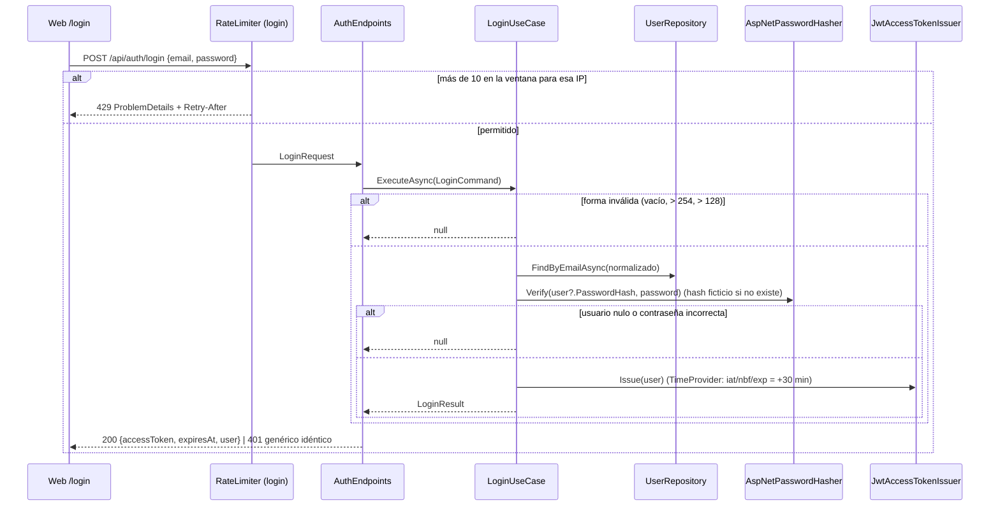
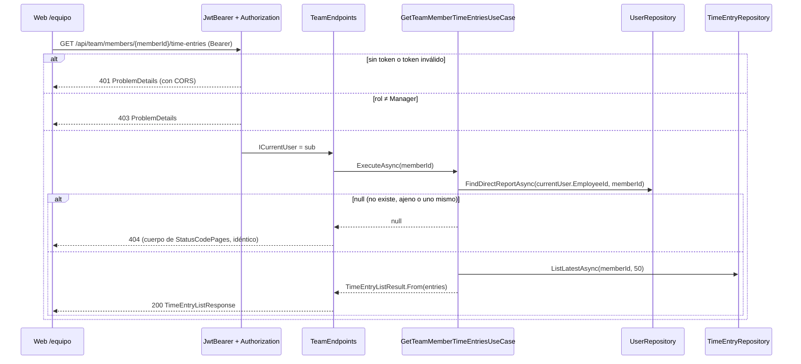

# Diseño: autenticacion-y-roles

Fecha: 2026-10-12 · Fase: sdd-design · Modo: openspec · Base: `proposal.md`, `exploration.md` (D1–D26 y Q1–Q15 aceptadas por delegación), código vigente de `src/` y `tests/`, specs vigentes de `openspec/specs/` y lecciones del cambio archivado `2026-10-12-fichaje-extremo-a-extremo` (xUnit v2, W4/`GetDocument.Insider`, `IHostedLifecycleService.StartingAsync`, `.editorconfig` de migraciones, `TimeProvider`, `DomainRuleException`, V8–V19 resueltas). Las specs se redactan en paralelo; la sección 19 recoge los conflictos esperables con las vigentes.

Convención: **DD-n** = decisión de diseño; **[V-n]** = validación que apply comprueba antes de dar el paso por bueno (sección 18). V1–V12 proceden de la exploración; V13–V24 son nuevas.

## 1. Enfoque técnico

Implementación mínima propia (D1): usuarios en PostgreSQL, contraseñas con `PasswordHasher<object>` (PBKDF2) y JWT HS256 emitido por la propia API y validado con `JwtBearer`. La identidad del que llama sale siempre del claim `sub`; `ICurrentUser` no cambia y los casos de uso de fichaje no se tocan (salvo el refactor `TimeEntryListResult.From`).

```
Web (Blazor WASM)                         Api (composition root)                         Application / Domain            Infrastructure
/login ──POST /api/auth/login────────────> AuthEndpoints ──> LoginUseCase ──> IUserRepository ─────────────────────> UserRepository ─> users
  │  token en sessionStorage + memoria        │                 │  IPasswordHasher <── AspNetPasswordHasher (PasswordHasher<object>)
  │                                           │                 └  IAccessTokenIssuer <── JwtAccessTokenIssuer (TimeProvider, HS256)
/fichajes, /equipo ──Bearer──> JwtBearer ─> FallbackPolicy / política Manager
  BearerTokenHandler (401 → /login)          HttpContextCurrentUser (sub) ─> ICurrentUser ─> ClockIn/ClockOut/GetTimeEntries
                                             TeamEndpoints ──> GetTeamMembers / GetTeamMemberTimeEntries ──> IUserRepository + ITimeEntryRepository
```

- **Domain** (100 %): `UserAccount` y `UserRole`, reglas puras sin dependencias.
- **Application** (≥ 80 %, sin paquetes): puertos `IUserRepository`, `IPasswordHasher`, `IAccessTokenIssuer`; `LoginUseCase`, `GetTeamMembersUseCase`, `GetTeamMemberTimeEntriesUseCase`.
- **Infrastructure**: tabla `users`, `UserConfiguration`, `UserRepository`, migración `AddUsers`.
- **Api**: JwtBearer, autorización (respaldo autenticado y política `Manager`), adaptadores de hash, emisor y usuario actual, endpoints `/api/auth/*` y `/api/team/*`, siembra, limitador, cabeceras, `UseStatusCodePages`, esquema Bearer en OpenAPI. Se elimina la identidad provisional.
- **Web**: sesión, proveedor de estado, handler Bearer, `/login`, `/equipo`, rutas protegidas. Solo oculta UI; los permisos viven en la API.

Se mantienen los 9 proyectos (sin proyecto de pruebas de Web: verificación manual, como en el cambio anterior).

## 2. Decisiones técnicas

| # | Decisión | Elección | Alternativas descartadas | Justificación |
|---|---|---|---|---|
| DD-1 | Mecanismo | JWT HS256 propio + `JwtBearer` + `PasswordHasher<object>` (D1) | ASP.NET Core Identity / `MapIdentityApi` (tokens opacos, 7 tablas); cookies (orígenes distintos 5172/5274, `SameSite`); OIDC externo | Mínima superficie; Application solo ve puertos; `PasswordHasher` viene en el marco compartido (sin paquete). ADR 0011. |
| DD-2 | Ubicación de adaptadores | Hash, emisor y `HttpContextCurrentUser` en **Api** | En Infrastructure | Dependen de ASP.NET Core (`Microsoft.AspNetCore.Identity`, `HttpContext`, `JwtBearer`); Infrastructure seguiría sin marco web. Api es el composition root (AGENTS §3). |
| DD-3 | Modelo | `UserAccount` (constructor privado único + `Create`), `UserRole { Employee, Manager }`, `ManagerId?` | Tablas de equipos/empleados; roles múltiples | YAGNI (D6); equipo = reportes directos (Q5). Mismo patrón que `TimeEntry` (enlace por constructor de EF). |
| DD-4 | Identificador de usuario | `Guid.CreateVersion7(now)` generado por quien crea (siembra) y pasado a `Create(id, …)` | `Guid.NewGuid()` en Domain | Domain no lee el reloj (ADR 0010). |
| DD-5 | Normalización del correo | `UserAccount.NormalizeEmail` = `Trim()` + `ToLowerInvariant()`; `Create` exige el correo ya normalizable y lo guarda en minúsculas; `CHECK email = lower(email)` | Índice sobre `lower(email)`; `citext` | Una sola regla en Domain; el índice único simple basta; la `CHECK` es defensa en profundidad. |
| DD-6 | Verificación con usuario inexistente | `IPasswordHasher.Verify(string? hash, string password)`: con `null` verifica contra un hash ficticio calculado una vez en el adaptador (singleton) y devuelve `false` | Saltar la verificación; `Task.Delay` | Tiempo similar exista o no el correo (enumeración, D3). Comprobable en Application con un doble que cuenta llamadas. |
| DD-7 | Entrada inválida en login | Correo en blanco o > 254, contraseña vacía o > 128 → `null` sin consultar ni hashear → mismo 401 | 400 de validación | No revela nada del usuario; el tope de 128 evita PBKDF2 sobre cadenas enormes (API4). Cuerpo ausente o JSON roto → 400 del enlace de Minimal API [V18]. |
| DD-8 | Emisión del token | `JsonWebTokenHandler` (`Microsoft.IdentityModel.JsonWebTokens`, transitivo de JwtBearer) con `SetDefaultTimesOnTokenCreation = false` y tiempos de `TimeProvider` | `JwtSecurityTokenHandler` (heredado); construir el JWT a mano | Handler actual de IdentityModel; tiempos deterministas con `FakeTimeProvider` [V15]. |
| DD-9 | Claims | `sub`, `name`, `email`, `role` (`Employee`/`Manager`), `jti`, `iat`, `nbf`, `exp`; `iss` = `timetracker-api`, `aud` = `timetracker-web` (constantes en código) | Emisor/audiencia por configuración | Una sola clave de configuración obligatoria (`Jwt:SigningKey`); emisor y audiencia no son secretos ni varían por entorno (YAGNI). |
| DD-10 | Validación del token | `ValidAlgorithms = [HS256]`, `RequireSignedTokens`, `RequireExpirationTime`, emisor y audiencia validados, `ClockSkew = 30 s`, `MapInboundClaims = false`, `NameClaimType = "name"`, `RoleClaimType = "role"`, `IncludeErrorDetails = false`; `OnTokenValidated` rechaza `sub` que no sea GUID no vacío o `role` desconocido | Valores por defecto (ClockSkew 5 min, mapeo de claims) | Cierra `alg: none`, confusión de algoritmo y tokens con `sub` inválido antes de llegar a `ICurrentUser` (D4, V4). `IncludeErrorDetails=false`: `WWW-Authenticate` sin `error_description` (A05). |
| DD-11 | Reloj en la validación | `JwtBearerOptions.TimeProvider` = el `TimeProvider` de DI; si IdentityModel no lo usa para la vida del token, `LifetimeValidator` propio con ese `TimeProvider` (≈ 10 líneas) [V6] | Reloj del sistema en la validación | `PostgresApiFactory` usa `FakeTimeProvider`: un token emitido en el reloj ficticio caducaría frente al reloj real. Permite probar la caducidad avanzando el reloj 31 min. |
| DD-12 | Duración | 30 min constante, sin refresh token | Refresh token; duración por configuración | Q2. Desviación consciente de AGENTS §6 («renovación controlada»), seguimiento en ADR 0011. |
| DD-13 | Autorización | `FallbackPolicy = RequireAuthenticatedUser`; política `Manager` (`RequireRole("Manager")`) en el grupo `/api/team`; `AllowAnonymous` solo en `/health`, `POST /api/auth/login` y `MapOpenApi()` | `RequireAuthorization()` grupo a grupo | Seguro por defecto: un endpoint nuevo nace protegido. Prueba de cobertura de autorización sobre `EndpointDataSource` (sección 14). Efecto lateral en 404/405 anónimos [V13]. |
| DD-14 | `ICurrentUser` | Sin cambios; `HttpContextCurrentUser(IHttpContextAccessor)` lee `sub`, registrado `Scoped` | Añadir `Role` al puerto | D9. El rol se aplica en Api (política); el control por objeto, en Application con `ManagerId`. |
| DD-15 | Control por objeto | `IUserRepository.FindDirectReportAsync(managerId, memberId)`; `null` (no existe, no es reporte, es uno mismo) → el caso de uso devuelve `null` → `TypedResults.NotFound()` sin cuerpo propio | Excepción de dominio; 403 para ajenos | 404 idéntico para inexistente y ajeno (Q7, BOLA/IDOR); el cuerpo lo pone `UseStatusCodePages`, igual que el 404 de una ruta con GUID mal formado (`{memberId:guid}`). |
| DD-16 | Lista del equipo | Solo `id` y `displayName`, por `DisplayName` ascendente, máximo 100 (`MaxMembers`) | Incluir correo; sin límite | Mínima exposición (API3) y lista acotada (API4). |
| DD-17 | Refactor de listado | `TimeEntryListResult.From(IReadOnlyList<TimeEntry>)` (suma de cerrados) usado por `GetTimeEntriesUseCase` y `GetTeamMemberTimeEntriesUseCase` | Duplicar el cálculo | D11, DRY; las pruebas actuales de `GetTimeEntries` respaldan el refactor (verde antes y después). |
| DD-18 | Errores HTTP | `UseStatusCodePages()` + `AddProblemDetails`; `CustomizeProblemDetails` pone título en español por estado **solo si `Detail` es nulo** (401, 403, 404, 405, 429; el 500 se mantiene) | Escribir cada cuerpo a mano | Uniforme y sin tocar los 409 ni el 401 de login (que llevan `detail`) [V9]. |
| DD-19 | Rate limiting | Política `login`: ventana fija 10/min por `RemoteIpAddress` (sin IP → partición `"sin-ip"`), `QueueLimit = 0`, `RejectionStatusCode = 429`, `OnRejected` añade `Retry-After` si hay metadato; cuerpo por StatusCodePages | Limitador global; deslizante | D12. `ForwardedHeaders` tras proxy: seguimiento antes de desplegar. |
| DD-20 | Cabeceras | `SecurityHeadersMiddleware` (primero del pipeline) que registra `Response.OnStarting`: `X-Content-Type-Options: nosniff`, `X-Frame-Options: DENY`, `Referrer-Policy: no-referrer`, `Content-Security-Policy: default-src 'none'; frame-ancestors 'none'`, y `Cache-Control: no-store` en `/api/*` | Fijarlas al entrar | `ExceptionHandler` limpia las cabeceras al tratar una excepción; `OnStarting` sobrevive y cubre también el 500. Sin HSTS (TLS en el ingreso, ADR 0007). |
| DD-21 | Orden del pipeline | SecurityHeaders → ExceptionHandler → StatusCodePages → CORS → RateLimiter → Authentication → Authorization → endpoints (enrutado implícito al inicio) | Auth antes que CORS | CORS antes de auth: el preflight se resuelve sin token y los 401/403/429 conservan `Access-Control-Allow-Origin` [V8]. |
| DD-22 | Siembra | `DemoUsersSeeder : IHostedService` con trabajo en `StartAsync`; migraciones siguen en `StartingAsync` | `StartingAsync` en ambos; código tras `Build()` | Todas las `StartingAsync` terminan antes de cualquier `StartAsync`: la siembra va después de migrar sea cual sea el orden de registro; los servicios del usuario arrancan antes que el servidor web [V16]; `WebApplicationFactory` y `GetDocument` interceptan `Build()` (lección DD-12 archivada). |
| DD-23 | Datos de siembra | 4 usuarios inventados (`marta.responsable@`, `luis.empleado@`, `ana.empleada@`, `pablo.empleado@example.test`); idempotente por correo; fuera de Development **no** se prohíbe | Prohibir fuera de Development; script SQL | AGENTS §8 pide usuario de prueba en el despliegue de demostración; queda desactivada por defecto y documentada (riesgo aceptado). |
| DD-24 | `.env.example` | `Jwt__SigningKey=` y `Seed__DemoPassword=` vacíos (activos), `Seed__DemoUsers=false`; el valor de demostración solo en README | Contraseña de demostración activa en `.env.example` (D20 literal) | Coherente con la regla vigente «sin contraseñas en `.env.example`» y su prueba `IsEmptyOrPlaceholder`. **Ajuste respecto a D20** (sección 19). |
| DD-25 | Token en la Web | `TokenStore`: copia en memoria + `sessionStorage` vía `IJSRuntime` (`sessionStorage.getItem/setItem/removeItem`, sin archivo JS propio) | `localStorage`; solo memoria | Q3/D16. Sobrevive a F5 en la pestaña, no a cerrar el navegador; XSS aceptado en ADR 0012. |
| DD-26 | Estado de autenticación | `JwtAuthenticationStateProvider` decodifica el payload (base64url), comprueba `exp`, no valida la firma; `ClaimsIdentity(claims, "jwt", "name", "role")` | Llamar a `/api/auth/me` en cada carga | D17. La UI solo oculta; la API decide. `/me` queda para verificación y clientes futuros. |
| DD-27 | Clientes HTTP de la Web | `BearerTokenHandler : DelegatingHandler` en `TimeEntriesApiClient` y `TeamApiClient` (un `HttpClient` propio cada uno, `InnerHandler = new HttpClientHandler()`); `AuthApiClient` **sin** handler | `AddHttpClient` (`Microsoft.Extensions.Http`) | D18/DD-17 archivada. El login no debe disparar la redirección de 401. Lógica común extraída a `Http/ApiRequest` y excepción renombrada a `ApiRequestException`. |
| DD-28 | OpenAPI | Transformador de documento: esquema `Bearer` (`http`, `bearer`, `JWT`) y requisito global; transformador de operación: `security: []` en operaciones con `IAllowAnonymous`; `.ProducesProblem(401)` en grupos protegidos y `403` en `/api/team` | Sin esquema | D23 [V7]. Primero en el orden de recorte. |
| DD-29 | Generación del contrato (W4) | `DocumentGeneration` sustituye `Identity:DevelopmentEmployeeId` por `Jwt:SigningKey` ficticia (≥ 32 bytes) y añade `Seed:DemoUsers = false` | Relajar el validador | Mismo mecanismo de DD-16 archivada, sin relajar validaciones en ejecución normal. |
| DD-30 | Compose | `api` publica `127.0.0.1:5274:8080`, `Seed__DemoUsers: "true"`, `Jwt__SigningKey: ${Jwt__SigningKey:?…}` y `Seed__DemoPassword: ${Seed__DemoPassword:?…}`; sigue en `Development` (Q14) | Mantener 8080 | La Web ya apunta a 5274 (D24): compose funciona con la Web sin tocar `ApiBaseUrl`. Fallo temprano y legible si faltan las claves. |

## 3. Estructura de archivos

### Domain (`src/TimeTracker.Domain`)
| Archivo | Acción | Tanda |
|---|---|---|
| `Users/UserAccount.cs`, `Users/UserRole.cs` | Crear | 1 |

### Application (`src/TimeTracker.Application`)
| Archivo | Acción | Tanda |
|---|---|---|
| `Users/IUserRepository.cs` | Crear | 1 |
| `Authentication/{IPasswordHasher, IAccessTokenIssuer, AccessToken, LoginCommand, LoginResult, UserSummary, LoginUseCase}.cs` | Crear | 1 |
| `Team/{TeamMemberResult, GetTeamMembersUseCase, GetTeamMemberTimeEntriesUseCase}.cs` | Crear | 1 |
| `TimeTracking/TimeEntryResult.cs` (añade `TimeEntryListResult.From`), `TimeTracking/GetTimeEntriesUseCase.cs` | Modificar (refactor) | 1 |
| `Identity/ICurrentUser.cs` | Sin cambios | — |

### Infrastructure (`src/TimeTracker.Infrastructure`)
| Archivo | Acción | Tanda |
|---|---|---|
| `Persistence/{UserConfiguration, UserRepository}.cs` | Crear | 2 |
| `Persistence/TimeTrackerDbContext.cs` (`DbSet<UserAccount> Users`), `Persistence/PersistenceServiceCollectionExtensions.cs` (registra `IUserRepository`) | Modificar | 2 |
| `Persistence/Migrations/<ts>_AddUsers.cs`, `.Designer.cs`, `TimeTrackerDbContextModelSnapshot.cs` | Generado (`dotnet tool run dotnet-ef migrations add AddUsers …`, mismo comando del README) | 2 |

### Api (`src/TimeTracker.Api`)
| Archivo | Acción | Tanda |
|---|---|---|
| `Identity/{DevelopmentCurrentUser, ProvisionalIdentityOptions, ProvisionalIdentityOptionsValidator, IdentityServiceCollectionExtensions}.cs` | **Eliminar** (y la carpeta) | 3a |
| `Authentication/{JwtOptions, JwtOptionsValidator, JwtDefaults, JwtAccessTokenIssuer, AspNetPasswordHasher, HttpContextCurrentUser, AuthenticationServiceCollectionExtensions, AuthEndpoints, LoginRequest, LoginResponse, UserResponse}.cs` | Crear | 3a |
| `Program.cs`, `Configuration/DocumentGeneration.cs`, `Errors/ProblemDetailsServiceCollectionExtensions.cs`, `Health/HealthEndpoints.cs` (`AllowAnonymous`), `TimeEntries/TimeEntryEndpoints.cs` (`ProducesProblem(401)`), `TimeTracker.Api.csproj` (+ JwtBearer) | Modificar | 3a |
| `Team/{TeamEndpoints, TeamMemberResponse}.cs` | Crear | 3b |
| `Seeding/{SeedOptions, SeedOptionsValidator, DemoUsers, DemoUsersSeeder, SeedingServiceCollectionExtensions}.cs` | Crear | 3b |
| `Security/{SecurityHeadersMiddleware, RateLimitingServiceCollectionExtensions}.cs` | Crear | 3b |
| `Configuration/OpenApiSecurityTransformers.cs` | Crear | 3b |

### Web (`src/TimeTracker.Web`)
| Archivo | Acción | Tanda |
|---|---|---|
| `Auth/{TokenStore, JwtAuthenticationStateProvider, BearerTokenHandler, AuthApiClient, LoginRequestDto, LoginResponseDto, ReturnUrl}.cs` | Crear | 4 |
| `Team/{TeamApiClient, TeamMemberDto}.cs`, `Pages/{Login.razor, Team.razor}`, `Shared/{TimeEntriesTable.razor, RedirectToLogin.razor}` | Crear | 4 |
| `Http/{ApiRequest, ApiRequestException}.cs` (lógica de `TimeEntriesApiClient` extraída; `ApiProblemDto` se mueve aquí) | Crear | 4 |
| `TimeEntries/TimeEntriesApiException.cs` | **Eliminar** (sustituida por `ApiRequestException`) | 4 |
| `Program.cs`, `App.razor`, `_Imports.razor`, `Layout/NavMenu.razor`, `Pages/TimeEntries.razor` (`[Authorize]`, usa `TimeEntriesTable`), `TimeEntries/TimeEntriesApiClient.cs`, `TimeTracker.Web.csproj` (+ Components.Authorization) | Modificar | 4 |

### Pruebas
| Archivo | Acción | Tanda |
|---|---|---|
| `tests/TimeTracker.Domain.Tests/UserAccountTests.cs` | Crear | 1 |
| `tests/TimeTracker.Application.Tests/{LoginUseCaseTests, GetTeamMembersUseCaseTests, GetTeamMemberTimeEntriesUseCaseTests}.cs`, `Fakes/{InMemoryUserRepository, FakePasswordHasher, FakeAccessTokenIssuer}.cs` | Crear | 1 |
| `tests/TimeTracker.Api.IntegrationTests/Persistence/UserRepositoryTests.cs`, `Support/UserSeed.cs` | Crear | 2 |
| `…/Persistence/MigrationTests.cs` (dos migraciones, tabla `users`) | Modificar | 2 |
| `…/TestTokens.cs`, `…/Startup/JwtStartupTests.cs`, `…/Authentication/{LoginEndpointTests, MeEndpointTests, TokenValidationTests}.cs`, `…/Security/AuthorizationCoverageTests.cs`, `…/TimeEntries/TimeEntryAuthenticationTests.cs` | Crear | 3a |
| `…/Startup/IdentityStartupTests.cs` | **Eliminar** (sustituida por `JwtStartupTests`) | 3a |
| `…/ApiFactory.cs`, `…/TimeEntries/PostgresApiFactory.cs`, `…/EnvironmentIsolation.cs`, `…/TimeEntries/TimeEntryIsolationTests.cs` (comentarios/identidad por token) | Modificar | 3a |
| `…/Team/TeamEndpointsTests.cs`, `…/Seeding/DemoUsersSeederTests.cs`, `…/Startup/SeedStartupTests.cs`, `…/Security/{LoginRateLimitTests, SecurityHeadersTests}.cs` | Crear | 3b |
| `…/CorsPolicyTests.cs` (preflight con `authorization`, CORS en 401) | Modificar | 3b |
| `tests/TimeTracker.ArchitectureTests/OpenApiContractTests.cs` | Modificar | 3b |
| `tests/TimeTracker.ArchitectureTests/{RepositoryConventionsTests, DeliveryArtifactsTests}.cs` | Modificar | 3a (appsettings) / 3b (compose, `.env`) / 5 (ADR, README) |

### Raíz y documentación
| Archivo | Acción | Tanda |
|---|---|---|
| `Directory.Packages.props` (+ `Microsoft.AspNetCore.Authentication.JwtBearer` 10.0.10, `Microsoft.AspNetCore.Components.Authorization` 10.0.10) | Modificar | 3a / 4 |
| `docker-compose.yml`, `.env.example` | Modificar | 3b |
| `docs/api/openapi.json` | Generado | 3a/3b |
| `docs/adr/0011-autenticacion-jwt-roles-y-equipo.md`, `docs/adr/0012-sesion-web-y-riesgo-xss.md` | Crear | 5 |
| `docs/adr/0009-identidad-provisional.md` | Modificar solo la línea `- Estado: Sustituido por el ADR 0011` (sin reescribir el cuerpo, AGENTS §8) | 5 |
| `README.md`, `openspec/config.yaml` | Modificar | 5 |

Sin cambios: `Dockerfile` (`HEALTHCHECK` sobre `/health` anónimo [V11]), `.github/workflows/ci.yml` (la auditoría ya cubre `Microsoft.IdentityModel.*` [V10]), `.editorconfig` (la regla `generated_code` de migraciones ya cubre `AddUsers`), `appsettings*.json`, `ICurrentUser`, `DesignTimeDbContextFactory`, páginas de plantilla `Counter`/`Weather`.

## 4. Interfaces y contratos

```csharp
// Domain/Users
public enum UserRole { Employee = 0, Manager = 1 }

public sealed class UserAccount
{
    public const int MaxEmailLength = 254;
    public const int MaxDisplayNameLength = 100;
    private UserAccount(Guid id, string email, string displayName, string passwordHash, UserRole role, Guid? managerId) { … }
    public Guid Id { get; }  public string Email { get; }  public string DisplayName { get; }
    public string PasswordHash { get; }  public UserRole Role { get; }  public Guid? ManagerId { get; }
    // ArgumentException: id vacío; correo en blanco, sin '@' o > 254; nombre en blanco o > 100; hash en blanco;
    // rol no definido; managerId vacío o igual a id. Guarda NormalizeEmail(email) y DisplayName.Trim().
    public static UserAccount Create(Guid id, string email, string displayName, string passwordHash, UserRole role, Guid? managerId);
    public static string NormalizeEmail(string email);   // Trim + ToLowerInvariant
}

// Application/Users
public interface IUserRepository
{
    Task<UserAccount?> FindByEmailAsync(string normalizedEmail, CancellationToken cancellationToken);
    Task<IReadOnlyList<UserAccount>> ListDirectReportsAsync(Guid managerId, int limit, CancellationToken cancellationToken); // DisplayName ASC
    Task<UserAccount?> FindDirectReportAsync(Guid managerId, Guid memberId, CancellationToken cancellationToken);           // null si no es reporte directo
    Task AddAsync(UserAccount user, CancellationToken cancellationToken);
}

// Application/Authentication
public interface IPasswordHasher
{
    string Hash(string password);
    /// <summary>Con <paramref name="passwordHash"/> nulo hace un trabajo equivalente contra un hash ficticio y devuelve false.</summary>
    bool Verify(string? passwordHash, string password);
}
public interface IAccessTokenIssuer { AccessToken Issue(UserAccount user); }
public sealed record AccessToken(string Value, DateTimeOffset ExpiresAt);
public sealed record LoginCommand(string? Email, string? Password);
public sealed record UserSummary(Guid Id, string Email, string DisplayName, UserRole Role) { public static UserSummary From(UserAccount user); }
public sealed record LoginResult(AccessToken Token, UserSummary User);
public sealed class LoginUseCase(IUserRepository users, IPasswordHasher hasher, IAccessTokenIssuer issuer)
{
    public const int MaxPasswordLength = 128;
    public Task<LoginResult?> ExecuteAsync(LoginCommand command, CancellationToken cancellationToken); // null → 401 genérico
}

// Application/Team
public sealed record TeamMemberResult(Guid Id, string DisplayName);
public sealed class GetTeamMembersUseCase(IUserRepository users, ICurrentUser currentUser)
{ public const int MaxMembers = 100; public Task<IReadOnlyList<TeamMemberResult>> ExecuteAsync(CancellationToken ct); }
public sealed class GetTeamMemberTimeEntriesUseCase(IUserRepository users, ITimeEntryRepository entries, ICurrentUser currentUser)
{ public Task<TimeEntryListResult?> ExecuteAsync(Guid memberId, CancellationToken ct); } // null → 404 idéntico

// Application/TimeTracking (refactor DD-17)
public sealed record TimeEntryListResult(IReadOnlyList<TimeEntryResult> Items, int TotalWorkedMinutes)
{ public static TimeEntryListResult From(IReadOnlyList<TimeEntry> entries); }
```

`LoginUseCase`: (1) forma inválida (DD-7) → `null`; (2) `FindByEmailAsync(NormalizeEmail(email))`; (3) `Verify(user?.PasswordHash, password)` **siempre**; (4) usuario nulo o verificación falsa → `null`; (5) `Issue(user)` → `LoginResult`. `SuccessRehashNeeded` cuenta como éxito; no se rehashea (YAGNI, anotado en ADR 0011).

### DTO de la API (`DateTime` UTC con `Z`, DD-14 archivada)
- `LoginRequest(string? Email, string? Password)`.
- `LoginResponse(string AccessToken, DateTime ExpiresAt, UserResponse User)`.
- `UserResponse(Guid Id, string Email, string DisplayName, string Role)` (`Role` como texto `Employee`/`Manager`).
- `TeamMemberResponse(Guid Id, string DisplayName)`; `TeamMemberListResponse(IReadOnlyList<TeamMemberResponse> Items)`.
- Fichajes del miembro: `TimeEntryListResponse` existente.

### Endpoints

| Método y ruta | Autorización | Éxito | Errores (ProblemDetails) |
|---|---|---|---|
| `GET /health` | Anónimo | 200 | — |
| `POST /api/auth/login` | Anónimo + `RequireRateLimiting("login")` | 200 `LoginResponse` | 400 (cuerpo ausente/ilegible), 401 genérico, 429 |
| `GET /api/auth/me` | Autenticado | 200 `UserResponse` (desde claims, sin BD) | 401 |
| `POST /api/time-entries/clock-in`, `…/clock-out`, `GET /api/time-entries` | Autenticado (respaldo) | sin cambios | + 401 |
| `GET /api/team/members` | `Manager` | 200 `TeamMemberListResponse` | 401, 403 |
| `GET /api/team/members/{memberId:guid}/time-entries` | `Manager` + control por objeto | 200 `TimeEntryListResponse` (50 últimos) | 401, 403, 404 idéntico |
| `GET /openapi/v1.json` (solo Development) | Anónimo | 200 | — |

### ProblemDetails (español, registro neutro)

| Caso | `status` | `title` | `detail` |
|---|---|---|---|
| Login fallido (cualquier causa) | 401 | Credenciales no válidas | El correo electrónico o la contraseña no son correctos. |
| Sin token / token inválido o caducado | 401 | Se requiere autenticación | (nulo) |
| Rol insuficiente | 403 | Acceso denegado | (nulo) |
| Miembro inexistente o ajeno; ruta inexistente | 404 | Recurso no encontrado | (nulo) |
| Método no permitido | 405 | Método no permitido | (nulo) |
| Límite de intentos | 429 | Demasiadas solicitudes | Espere un minuto antes de volver a intentarlo. (+ `Retry-After`) |
| 409 de fichajes y 500 | sin cambios | | |

### OpenAPI
`components.securitySchemes.Bearer = { type: http, scheme: bearer, bearerFormat: JWT }`, `security: [{ Bearer: [] }]` global y `security: []` en `/health` y `/api/auth/login`. Rutas nuevas con sus códigos; ningún parámetro ni propiedad `employeeId` (`memberId` sí).

## 5. Secuencias





```mermaid
sequenceDiagram
  participant P as Program.cs
  participant V as ValidateOnStart (Cors, ConnectionStrings, Database, Jwt, Seed)
  participant M as DatabaseMigrationHostedService
  participant S as DemoUsersSeeder
  participant K as Kestrel (GenericWebHostService)
  P->>V: Build(); Run()
  alt alguna inválida
    V-->>P: OptionsValidationException/AggregateException (nombra la clave, nunca el valor)
  else
    P->>M: StartingAsync → migra si Database:ApplyMigrationsOnStartup
    P->>S: StartAsync → si Seed:DemoUsers, crea los que falten (por correo)
    P->>K: StartAsync → escucha
  end
```

## 6. Esquema SQL y migración `AddUsers`

```sql
CREATE TABLE users (
  id            uuid          PRIMARY KEY,
  email         varchar(254)  NOT NULL,
  display_name  varchar(100)  NOT NULL,
  password_hash text          NOT NULL,
  role          varchar(20)   NOT NULL,
  manager_id    uuid          NULL,
  CONSTRAINT ck_users_role CHECK (role IN ('Employee', 'Manager')),
  CONSTRAINT ck_users_manager_not_self CHECK (manager_id IS NULL OR manager_id <> id),
  CONSTRAINT ck_users_email_lowercase CHECK (email = lower(email)),
  CONSTRAINT fk_users_users_manager_id FOREIGN KEY (manager_id) REFERENCES users (id) ON DELETE RESTRICT
);
CREATE UNIQUE INDEX ux_users_email ON users (email);
CREATE INDEX ix_users_manager_id ON users (manager_id);
```

- `UserConfiguration`: `ToTable("users", t => t.HasCheckConstraint(…)×3)`, `HasColumnName` explícitos (DD-13 archivada), `Role` con `HasConversion<string>().HasMaxLength(20)`, `HasOne<UserAccount>().WithMany().HasForeignKey(u => u.ManagerId).OnDelete(DeleteBehavior.Restrict).HasConstraintName("fk_users_users_manager_id")`, `Id` `ValueGeneratedNever()`.
- Sin FK de `time_entries.employee_id` a `users` (D7); los fichajes de la identidad provisional quedan huérfanos (`docker compose down -v`).
- `UserRepository`: solo LINQ parametrizado, `AsNoTracking` en lecturas; `AddAsync` con `SaveChangesAsync` (sin traducción de `23505`: solo la usa la siembra, que comprueba antes por correo).
- Pruebas: `MigrateAsync` (nunca `EnsureCreated`), `HasPendingModelChanges() == false`, migración generada sin cambios de `dotnet format` [V5 archivada; regla `.editorconfig` vigente].

## 7. Configuración y validación (ADR 0007)

| Clave (variable) | Validación | Mensaje (nombra la clave, nunca el valor) |
|---|---|---|
| `Jwt:SigningKey` (`Jwt__SigningKey`) | `JwtOptionsValidator` + `ValidateOnStart`; obligatoria; `Encoding.UTF8.GetByteCount ≥ 32` | «Jwt:SigningKey: debe definirse.» / «Jwt:SigningKey: debe tener al menos 32 bytes.» |
| `Seed:DemoUsers` (`Seed__DemoUsers`) | `bool`, por defecto `false`; no booleano → fallo de enlace que nombra la clave | (binder) |
| `Seed:DemoPassword` (`Seed__DemoPassword`) | `SeedOptionsValidator`: si `DemoUsers` es `true`, obligatoria y ≥ 12 caracteres | «Seed:DemoPassword: debe tener al menos 12 caracteres cuando Seed:DemoUsers es true.» |
| `Identity:DevelopmentEmployeeId` | **Retirada** (clase, opción, validador, extensión, prueba, README, `.env.example`, `EnvironmentIsolation`, `DocumentGeneration`) | — |
| `Cors:*`, `ConnectionStrings:Default`, `Database:*` | Sin cambios | — |

Consecuencia: la API **ya puede arrancar fuera de Development** (con configuración válida). Ninguna de estas claves va en `appsettings*.json` (prueba). README: generar la clave con `[Convert]::ToBase64String([Security.Cryptography.RandomNumberGenerator]::GetBytes(48))` (64 caracteres).

## 8. Pipeline (`Program.cs`)

```csharp
builder.Services.AddRestrictiveCors();
builder.Services.AddDatabaseConfiguration();
builder.Services.AddJwtAuthentication();      // opciones+validador, JwtBearer, políticas, ICurrentUser, hasher, emisor, LoginUseCase
builder.Services.AddLoginRateLimiting();
builder.Services.AddDemoUserSeeding();        // opciones+validador, DemoUsersSeeder (después de AddDatabaseConfiguration)
builder.Services.AddDomainProblemDetails();   // + títulos por estado (DD-18)
builder.Services.AddTimeEntries();
builder.Services.AddTeam();
builder.Services.AddOpenApi(options => options.AddBearerSecurity());

var app = builder.Build();
app.UseSecurityHeaders();       // OnStarting: también en 401/404/429/500
app.UseExceptionHandler();
app.UseStatusCodePages();       // cuerpos ProblemDetails para 401/403/404/405/429 sin cuerpo
app.UseCors();                  // antes de auth: preflight sin token; CORS en errores
app.UseRateLimiter();
app.UseAuthentication();
app.UseAuthorization();
if (app.Environment.IsDevelopment()) { app.MapOpenApi().AllowAnonymous(); }
app.MapHealthEndpoints();       // .AllowAnonymous()
app.MapAuthEndpoints();
app.MapTimeEntryEndpoints();
app.MapTeamEndpoints();         // grupo .RequireAuthorization("Manager")
```

## 9. Hash de contraseñas

`AspNetPasswordHasher : IPasswordHasher` (singleton) envuelve `PasswordHasher<object>` (formato V3, PBKDF2, 100.000 iteraciones por defecto; PRF a confirmar [V3]). El constructor calcula una vez el hash ficticio de un GUID aleatorio. `Verify(null, p)` verifica contra él y devuelve `false`; `Verify(h, p)` devuelve `true` con `Success` o `SuccessRehashNeeded`. Nunca registra contraseñas ni hashes.

## 10. Siembra

`DemoUsersSeeder(IOptions<SeedOptions>, IServiceScopeFactory, TimeProvider, ILogger)`: si `DemoUsers` es `false`, no hace nada. Si es `true`, en un ámbito: para Marta (Manager) y después Luis y Ana (con `ManagerId` = id de Marta, existente o nueva) y Pablo (sin responsable), crea con `UserAccount.Create(Guid.CreateVersion7(now), …, hasher.Hash(DemoPassword), …)` solo si `FindByEmailAsync` no lo encuentra. Registra con `LoggerMessage` cuántos creó, sin correos ni contraseñas. Si la base no está disponible, el arranque falla (fallo rápido con la bandera activa). Si la contraseña de demostración cambia, los usuarios existentes no se actualizan (documentado: `docker compose down -v`).

## 11. Web

- `Program.cs`: `AddAuthorizationCore()`, `AddCascadingAuthenticationState()`, `TokenStore` y `JwtAuthenticationStateProvider` scoped (también registrado como `AuthenticationStateProvider`), `AuthApiClient` (sin handler), `TimeEntriesApiClient` y `TeamApiClient` con `BearerTokenHandler`; `ApiBaseUrl` igual que hoy.
- `App.razor`: `AuthorizeRouteView`; `NotAuthorized` → `RedirectToLogin` si no hay sesión, «No tiene permiso para ver esta página.» si la hay.
- `JwtAuthenticationStateProvider`: `SignInAsync(token)`, `SignOutAsync()`; payload ilegible o `exp` vencido → sesión limpia y anónimo.
- `BearerTokenHandler`: añade `Authorization: Bearer`; ante 401 → `SignOutAsync()` y `NavigateTo("login?returnUrl=…")`.
- `ReturnUrl.IsSafe`: solo rutas relativas que empiezan por `/` y no por `//` ni `/\` (redirección abierta).
- Rutas: `/login` (anónima; formulario `EditForm` con correo y contraseña; 401 → «Correo o contraseña incorrectos.»; 429 → «Demasiados intentos. Espere un minuto e inténtelo de nuevo.»; otro → genérico), `/fichajes` (`[Authorize]`), `/equipo` (`[Authorize(Roles = "Manager")]`: lista de miembros y, al elegir uno, `TimeEntriesTable` en solo lectura).
- `NavMenu`: `AuthorizeView` → «Fichajes»; `Roles="Manager"` → «Equipo»; nombre del usuario y «Cerrar sesión»; sin sesión → «Iniciar sesión». Roles en español en la UI (Q4): «Empleado», «Responsable».
- Sin `MarkupString` ni HTML sin escapar; el token nunca se registra en consola.

## 12. Compose, Docker, CI, `.env.example`, README

- `docker-compose.yml` (`api`): `ports: "127.0.0.1:5274:8080"`; `environment` añade `Seed__DemoUsers: "true"`, `Jwt__SigningKey: ${Jwt__SigningKey:?Defina Jwt__SigningKey en .env}`, `Seed__DemoPassword: ${Seed__DemoPassword:?Defina Seed__DemoPassword en .env}`; comentario de cabecera actualizado (ya no hay identidad provisional; sigue solo en `127.0.0.1` por la contraseña de demostración pública). `postgres` sin cambios.
- `.env.example`: quita `Identity__DevelopmentEmployeeId`; añade `Jwt__SigningKey=` (comentario: comando de generación), `Seed__DemoUsers=false`, `Seed__DemoPassword=` (comentario: solo local, ≥ 12 caracteres, ver README).
- `Dockerfile` y `ci.yml`: sin cambios.
- README: estado (autenticación real, roles), tabla de variables (`Jwt__SigningKey`, `Seed__*`, sin `Identity__*`), ejecución local con `$env:Jwt__SigningKey`, compose en `http://localhost:5274` con `Cors__AllowedOrigins__0=http://localhost:5172`, usuarios de prueba inventados con la contraseña de demostración `Demo-Fichajes-2026` (solo local; no activar la siembra en un despliegue real sin cambiarla), aviso de `docker compose down -v` para datos huérfanos, 12 ADR.

## 13. ADR

| Archivo | Decisión | Alternativas | Consecuencias |
|---|---|---|---|
| `0011-autenticacion-jwt-roles-y-equipo.md` (Aceptado; sustituye al 0009) | DD-1, DD-6, DD-9 a DD-13, DD-15, DD-19, DD-22/23; sin refresh token; sin FK en `time_entries` | Identity/`MapIdentityApi`, cookies, OIDC, refresh token, FK ahora | Disparadores de revisión: refresh token antes de sesiones largas o despliegue público; FK al añadir alta/baja de usuarios; `ForwardedHeaders` antes de desplegar tras proxy; rehash si cambian los parámetros de PBKDF2 |
| `0012-sesion-web-y-riesgo-xss.md` (Aceptado) | DD-25 a DD-27 | Cookies HttpOnly (BFF), `localStorage`, solo memoria | Riesgo XSS aceptado con mitigaciones (30 min, sin HTML crudo, cabeceras en API); CSP de la Web al servir estáticos (fuera) |
| `0009-identidad-provisional.md` | Solo `- Estado: Sustituido por el ADR 0011` | — | Total 12 ADR |

## 14. Estrategia de pruebas (Strict TDD) y trazabilidad

Cada paso: rojo → verde → refactor; las que pasen a la primera se justifican con mutación temporal (como en el cambio archivado).

**Domain — `UserAccountTests`** (100 % líneas y ramas): 1 `Create_WithValidData_SetsProperties` · 2 `Create_NormalizesEmailToLowerAndTrims` · 3 `Create_TrimsDisplayName` · 4 `Create_WithEmptyId_Throws` · 5 `Create_WithBlankOrMalformedOrTooLongEmail_Throws` (Theory) · 6 `Create_WithBlankOrTooLongDisplayName_Throws` · 7 `Create_WithBlankPasswordHash_Throws` · 8 `Create_WithUndefinedRole_Throws` · 9 `Create_WithManagerIdEqualToId_Throws` · 10 `Create_WithEmptyManagerId_Throws` · 11 `Create_WithManagerId_KeepsIt` · 12 `NormalizeEmail_LowersInvariant`.

**Application** (fakes en memoria): `LoginUseCase` → credenciales válidas devuelven token y resumen; contraseña incorrecta → `null`; correo inexistente → `null` **y `Verify` llamado una vez con hash nulo**; correo en mayúsculas/espacios encuentra al usuario; forma inválida (vacío, 255 caracteres, contraseña 129) → `null` sin consultar ni verificar; el emisor recibe el usuario correcto. `GetTeamMembersUseCase` → solo reportes directos del usuario actual, límite 100 pasado al repositorio, vacío si no hay. `GetTeamMemberTimeEntriesUseCase` → miembro propio devuelve lista y total; ajeno, inexistente y uno mismo → `null` y **no** consulta fichajes; límite 50. Refactor `TimeEntryListResult.From` con las pruebas existentes en verde.

**Integración (Testcontainers `postgres:18-alpine`; `ApiFactory` sin BD para lo que falla antes de la BD)**:

| Área | Pruebas |
|---|---|
| Repositorio de usuarios | ida y vuelta; búsqueda por correo normalizado; `ListDirectReportsAsync` (orden, límite, excluye no reportes); `FindDirectReportAsync` (propio, ajeno, inexistente); correo duplicado → `23505 ux_users_email`; `CHECK` de rol, de auto-responsable y de minúsculas; FK `RESTRICT` |
| Migraciones | dos migraciones (`_InitialTimeEntries`, `_AddUsers`); tabla `users`, índices y restricciones; `HasPendingModelChanges() == false` |
| Login | 200 con forma y `expiresAt` = reloj ficticio + 30 min (`Z`); contraseña incorrecta y correo inexistente → **mismo cuerpo** 401; correo con mayúsculas → 200; cuerpo vacío → 400; el token devuelto sirve para `/api/auth/me` |
| Validación del token | sin token → 401 ProblemDetails en español; firma con otra clave; `alg: none`; emisor y audiencia ajenos; caducado (reloj +31 min); `nbf` futuro; `sub` no GUID; `role` desconocido → 401; `WWW-Authenticate` sin `error_description` |
| Fichajes | 401 sin token en los tres endpoints; la identidad sale de `sub` (aislamiento existente con tokens de dos usuarios); `?employeeId=` y `X-Employee-Id` siguen ignorados |
| Equipo | empleado → 403; responsable ve solo sus reportes; fichajes de un reporte → 200; ajeno e inexistente → 404 con **cuerpo idéntico**; GUID mal formado → 404; uno mismo → 404 |
| Limitador | 10 logins → no 429; el 11.º → 429 ProblemDetails con `Retry-After`; `/api/auth/me` no se limita |
| Cabeceras | presentes en 200, 401, 404 y 500; `Cache-Control: no-store` en `/api/*` |
| CORS | preflight `OPTIONS` con `Access-Control-Request-Headers: authorization` permitido; 401 y 429 con `Access-Control-Allow-Origin` [V8] |
| Cobertura de autorización | recorre `EndpointDataSource`: todo endpoint salvo la lista blanca (`/health`, `POST /api/auth/login`, documento OpenAPI) carece de `IAllowAnonymous`; `/api/team/*` exige la política `Manager` |
| Arranque | sin `Jwt:SigningKey` y con 31 bytes → falla nombrando la clave y sin imprimir el valor; `Seed:DemoUsers=true` sin contraseña o con 11 caracteres → falla; no booleano → falla; `Production` con configuración válida → arranca (sustituye a «fuera de Development») |
| Siembra | bandera activa crea 4 usuarios con la relación correcta y el login de Marta funciona; segunda ejecución no duplica; bandera inactiva no crea nada |

**Apoyo de pruebas**: `TestTokens.Create(Guid userId, string role, DateTimeOffset issuedAt, TimeSpan? lifetime = null, string? signingKey = null, string issuer = …, string audience = …)` construye JWT de forma independiente del emisor de producción (también `CreateUnsigned` para `alg: none`); vida por defecto 30 días para que `Clock.Advance` en pruebas de fichaje no caduque el token. `ApiFactory` añade `Jwt:SigningKey` ficticia (≥ 32 bytes, constante `ValidSigningKey`) y, en `ConfigureClient`, cabecera Bearer de `DefaultUserId` con rol `Employee` [V14]; las pruebas anónimas quitan la cabecera. `PostgresApiFactory(connectionString, employeeId?, role = "Employee")` emite el token con `Clock.GetUtcNow()`. `EnvironmentIsolation`: prefijos `Cors__`, `ConnectionStrings__`, `Database__`, `Jwt__`, `Seed__`. `UserSeed` inserta usuarios con correo único (`…{Guid:N}@example.test`) y `PasswordHasher<object>`.

**Pruebas de arquitectura y entrega a actualizar**: `ExportedDocument_DoesNotExposeEmployeeId` (se mantiene; debe seguir en verde con `memberId`); nuevas `ExportedDocument_ContainsAuthAndTeamEndpoints` (200/400/401/429; 200/401; 200/401/403; 200/401/403/404) y `ExportedDocument_DeclaresBearerScheme`; `AppSettings_ContainNoSensitiveKeys` (prohíbe `ConnectionStrings`, `Database`, `Identity`, `Jwt`, `Seed`); `DeliveryArtifactsTests`: claves de `.env.example` (sin `Identity__`, con `Jwt__SigningKey` y `Seed__DemoPassword` vacías y `Seed__DemoUsers=false`), compose `"127.0.0.1:5274:8080"` y `Seed__DemoUsers: "true"`, `Adr_Directory_HasTwelveAdrsWithFourSections`, README con `Jwt__SigningKey`, `/login`, `/equipo`, `example.test` y **sin** `Identity__`; nueva `Code_HasNoProvisionalIdentityLeftovers` (sin `DevelopmentCurrentUser`, `ProvisionalIdentity` ni `Identity:DevelopmentEmployeeId` en `src/` y `tests/`).

**Cobertura**: Domain 100 % (líneas y ramas); Application ≥ 80 % medido solo con `Application.Tests` (V17 archivada); Infrastructure, Api y Web sin umbral.

**Trazabilidad** (los identificadores los fijan las specs): `authentication` → `LoginUseCaseTests`, login, validación del token, limitador, cabeceras, arranque `Jwt`, siembra; `team-access` → `UserAccountTests`, casos de equipo, `TeamEndpointsTests`, cobertura de autorización; `web-session` → verificación manual registrada en `verify-report.md`; `time-tracking` → 401 y aislamiento por token; `startup-configuration` → `JwtStartupTests`, `SeedStartupTests`, entrega; `solution-architecture` → contrato, entrega, arquitectura; `time-entries-persistence` → migraciones y repositorio; `time-entries-ui` → manual.

## 15. Matriz de amenazas (OWASP Top 10 web y API)

| Amenaza | Aplica | Respuesta de diseño | Prueba RED / verificación |
|---|---|---|---|
| BOLA/IDOR (API1, A01) | Sí | Identidad solo de `sub`; `FindDirectReportAsync(manager, member)`; 404 idéntico; fichajes filtrados por `sub` | Equipo: ajeno/inexistente/uno mismo 404 idéntico; aislamiento por token |
| Autorización por función (API5) | Sí | Respaldo autenticado + política `Manager` | Empleado → 403; prueba de cobertura de autorización |
| Fuerza bruta (API4, A07) | Sí | 10/min por IP en login; PBKDF2 100k; contraseña ≤ 128 | 11.º intento → 429. Residual: ataque distribuido y IP tras proxy (seguimiento) |
| Enumeración de usuarios (A07) | Sí | 401 con cuerpo idéntico; verificación contra hash ficticio | Cuerpos iguales; `Verify` llamado con hash nulo (unitaria) |
| Token forjado, `alg: none`, confusión de algoritmo (API2, A02) | Sí | `ValidAlgorithms=[HS256]`, firma obligatoria, clave ≥ 32 bytes, emisor/audiencia, `OnTokenValidated` | Pruebas de validación del token |
| Token robado / XSS (A03, A07) | Sí (aceptado) | 30 min; sin HTML crudo en Blazor; cabeceras; ADR 0012 | Revisión: sin `MarkupString` ni `innerHTML` en `src/TimeTracker.Web` |
| Redirección abierta | Sí | `ReturnUrl.IsSafe` | Verificación manual con `returnUrl=//ejemplo.test` |
| Secretos (A02, A05) | Sí | Clave solo por entorno; validada sin imprimirla; fuera de `appsettings`; `.env.example` vacío | `JwtStartupTests`; `AppSettings_ContainNoSensitiveKeys`; `EnvExample_HasNoRealValues` |
| Datos en logs (A09) | Sí | Sin correo, contraseña, hash, token ni IP en logs propios; `IncludeErrorDetails=false`; PII de IdentityModel desactivada (por defecto) | Revisión en verify de los `LoggerMessage`; registro del login fallido sin datos |
| Exposición de errores (API8) | Sí | ProblemDetails genéricos en español | Cuerpos de 401/403/404/429 sin trazas |
| CORS (API8) | Sí | Sin cambios de código; orden CORS antes de auth; sin `AllowCredentials` | Preflight y CORS en 401/429 |
| DoS (API4) | Sí | Listas acotadas (50, 100); tope de contraseña; limitador de login | Límite pasado al repositorio (unitarias) |
| Asignación masiva (API3) | Sí (mínima) | `LoginRequest` solo con dos campos; respuestas sin hash | Contrato: `UserResponse` sin `passwordHash` |
| Contraseña de demostración pública | Sí (aceptado) | Siembra desactivada por defecto; compose en `127.0.0.1`; README avisa | `EnvExample` con `Seed__DemoUsers=false` |
| Inyección SQL (A03) | Sí (mitigada) | Solo LINQ parametrizado | Revisión: sin `FromSqlRaw`/`ExecuteSqlRaw` en `src/` |

Matriz de procesos de la skill (rutas de documentación, selección de repositorio Git, estado de commit/push, comandos de PR): **N/A**: el cambio no ejecuta Git, PR, subprocesos ni clasifica ejecutables; el enrutado afectado es HTTP y se cubre arriba.

## 16. Tandas, previsión y recorte

| Tanda | Contenido | Líneas a mano (previsión de diseño) | Punto de control |
|---|---|---|---|
| 1 | V1/V2 (restore de paquetes); Domain + Application con TDD; refactor `From` | 450–600 | build, test, cobertura 100 / ≥ 80 |
| 2 | `UserConfiguration`, repositorio, `AddUsers`, `UserSeed`, pruebas de repositorio y migraciones | 150–220 | repositorio y `HasPendingModelChanges` en verde |
| 3a | JwtBearer, emisor, hasher, `HttpContextCurrentUser`, login/me, respaldo, retirada de la identidad provisional, `TestTokens`, migración de fábricas y pruebas, `DocumentGeneration` | 550–700 | 200/401 en verde; `Code_HasNoProvisionalIdentityLeftovers` en verde |
| 3b | Equipo y `Manager`, siembra, limitador, cabeceras, StatusCodePages, OpenAPI, compose 5274, `.env.example` | 600–750 | 403/404/429 probados; `docker compose up` y login en `http://localhost:5274` |
| 4 | Web completa | 450–600 | flujo manual de empleado y responsable registrado |
| 5 | ADR 0011/0012, estado del 0009, README, `config.yaml`, pruebas de entrega | 200–280 | 12 ADR; entrega en verde |
| **Total** | | **≈ 2.400–3.150** (sin migraciones generadas ni `openapi.json`) | |

La propuesta estima 1.490–1.955; el cambio anterior superó su previsión ≈ 1,8× (S5 del verify archivado), y esta previsión incluye las pruebas de seguridad. Orden de recorte (proposal): esquema OpenAPI Bearer (DD-28) → cabeceras (DD-20) → rate limiting (DD-19) → pulido de equipo (selector en `/equipo`, `TimeEntriesTable` compartida) → fusionar ADR 0012 en 0011. No se recortan: backend, control de acceso, retirada de la identidad provisional ni pruebas de seguridad.

- Decision needed before apply: No (`size:exception` aceptado)
- Chained PRs recommended: No (sin repositorio; las tandas son los puntos de control)
- 400-line budget risk: High

Reversión: copia previa de los archivos a modificar o eliminar en `..\TimeTracker.rollback\<tanda>\` (proposal), sin Git.

## 17. Riesgos

- Calendario (13 días; previsión mayor que la de la propuesta).
- `FallbackPolicy` convierte en 401 los 404/405 anónimos [V13].
- Reloj de validación del token frente a `FakeTimeProvider` [V6].
- Rate limiting por IP: en `TestServer` no hay IP (partición única por fábrica) [V17]; tras proxy, todos comparten IP hasta `ForwardedHeaders`.
- XSS con token en `sessionStorage`; sin refresh token; contraseña de demostración pública.
- Sin FK en `time_entries`; un usuario borrado conserva un token válido hasta 30 min.
- La Web sigue sin pruebas automáticas; la lógica de `JwtAuthenticationStateProvider` y `ReturnUrl` solo se verifica a mano.
- CI sin ejecutar y dependiente de Docker (W3/W5 archivadas).

## 18. Validaciones para apply

| ID | Validación | Respaldo |
|---|---|---|
| V1 | `JwtBearer` 10.0.10 restaura sin NU190x con `-warnaserror`; `Microsoft.IdentityModel.*` transitivos sin vulnerabilidades | 10.0.12; fijar la versión transitiva corregida (como `Microsoft.OpenApi`) |
| V2 | `Components.Authorization` 10.0.10 compatible con `Components.WebAssembly` 10.0.10 | 10.0.12 en ambos |
| V3 | Formato V3 de `PasswordHasher` en .NET 10 (PRF e iteraciones); anotar en ADR 0011 | — |
| V4 | Con `MapInboundClaims=false`, `sub` y `role` llegan sin renombrar; `RequireRole` y `[Authorize(Roles)]` funcionan con `RoleClaimType="role"` | Ajustar `RoleClaimType` |
| V5 | 401 (sin token, token inválido) y 403 (rol) con ProblemDetails en español | Escribir el cuerpo en `JwtBearerEvents.OnChallenge/OnForbidden` |
| V6 | `JwtBearerOptions.TimeProvider` gobierna la vida del token | `LifetimeValidator` propio con el `TimeProvider` de DI (DD-11) |
| V7 | API de `Microsoft.OpenApi` 2.7.6 para esquemas de seguridad y referencia (`OpenApiSecuritySchemeReference`) | Recortar DD-28 |
| V8 | CORS en 401/403/429 y preflight con `authorization` | Reordenar middleware |
| V9 | `UseStatusCodePages` + `CustomizeProblemDetails` da el 429 y el 404 con título en español y no pisa el 401 de login ni los 409 | `OnRejected` escribe el cuerpo |
| V10 | `dotnet list package --vulnerable --include-transitive` limpio | Fijado transitivo |
| V11 | `/health` anónimo; `HEALTHCHECK` sano en compose | — |
| V12 | `docker compose up` con siembra y login de Marta en `http://localhost:5274` | — |
| V13 | Con `FallbackPolicy`, `POST /health` y rutas inexistentes **sin token** responden 401 (no 405/404) | Aceptar y anotar en la spec `api-health`; o política por grupos en lugar de respaldo |
| V14 | `ConfigureClient` de `ApiFactory` se conserva tras `WithWebHostBuilder` | Ayudante `CreateAuthenticatedClient()` |
| V15 | `JsonWebTokenHandler` con `SetDefaultTimesOnTokenCreation=false` usa `IssuedAt/NotBefore/Expires` del descriptor | Claims `iat/nbf/exp` explícitos |
| V16 | `StartAsync` de `DemoUsersSeeder` corre después de todas las `StartingAsync` y antes de que Kestrel escuche, también en `WebApplicationFactory` | `StartingAsync` registrada después de la de migraciones |
| V17 | Partición del limitador sin `RemoteIpAddress` en `TestServer`; pruebas aisladas por fábrica | Fijar `RemoteIpAddress` en la prueba con un middleware de arranque |
| V18 | Cuerpo de login ausente o JSON roto → 400 (no 500) en Development y Production | `StatusCodeSelector` de `ExceptionHandlerOptions` para `BadHttpRequestException` |
| V19 | `IJSRuntime.InvokeAsync("sessionStorage.getItem")` sin archivo JS propio | Pequeño `wwwroot/js/session.js` |
| V20 | Reglas CA nuevas (CA1848, CA1062, CA2000 con `HttpClientHandler`, CA5404 en validación del token) | Cumplir con prueba; nunca desactivar `TreatWarningsAsErrors` |
| V21 | `GetDocument.Insider` genera el contrato con la clave ficticia y sin ejecutar la siembra | Ajustar `DocumentGeneration` |
| V22 | `MapOpenApi().AllowAnonymous()` sirve el documento en Development sin token | — |
| V23 | Un 401 de `JwtBearer` no incluye `error_description` | `IncludeErrorDetails=false` (ya previsto) |
| V24 | EF enlaza `UserAccount` por constructor con `Role` convertido a texto y Domain llega al 100 % sin `ExcludeFromCodeCoverage` | Campos de respaldo |

## 19. Conflictos esperables con las especificaciones vigentes

| Spec vigente | Requisito / escenario | Conflicto | Delta necesario |
|---|---|---|---|
| time-tracking | «Identidad provisional mediante ICurrentUser» (4 escenarios con `Identity:DevelopmentEmployeeId`) | La identidad sale de `sub` | **REMOVED** + ADDED «Identidad desde el token» (conserva `?employeeId=`, `X-Employee-Id` ignorados y contrato sin `employeeId`) |
| time-tracking | «Contrato REST de fichajes» | Todos exigen autenticación; nuevo 401 | MODIFIED |
| time-tracking | `Purpose` («identidad provisional») | Obsoleto | Nota en el delta |
| startup-configuration | «Identidad provisional solo en Development» | Se elimina; la API arranca en cualquier entorno | **REMOVED** + ADDED `Jwt:SigningKey` y `Seed:*` |
| startup-configuration | «Documentación de claves en `.env.example`» («seis claves», incluida `Identity__…`) | Cambia el conjunto de claves | MODIFIED |
| startup-configuration | «Puerto configurable» (exige `Identity__…` y Development) | Necesita `Jwt__SigningKey`; ya no exige Development | MODIFIED |
| solution-architecture | «Imagen Docker», escenario «Salud dentro del contenedor» | `Jwt__SigningKey` en lugar de `Identity__…`; sin Development obligatorio | MODIFIED |
| solution-architecture | «Docker Compose con API y PostgreSQL» (puerto 8080, `.env` con GUID) | 5274, `Jwt__SigningKey`, siembra | MODIFIED (destructivo: puerto) |
| solution-architecture | «ADR y README» (0001–0010, `Identity__…`) | 12 ADR, 0009 «Sustituido», README con `Jwt__*`/`Seed__*`, usuarios de prueba | MODIFIED |
| solution-architecture | «Exportación del contrato OpenAPI sin base de datos ni identidad real» | Valor ficticio `Jwt:SigningKey`; rutas nuevas | MODIFIED |
| solution-architecture | «Puerta de calidad local», «Pruebas en verde» | Lista de pruebas | MODIFIED recomendado |
| time-entries-persistence | «Migraciones reales…», «Migración sobre base vacía» («se aplica la migración inicial») | Dos migraciones | MODIFIED |
| time-entries-persistence | «Conexión perezosa y salud independiente» (menciona `Identity:…`) | Texto obsoleto | MODIFIED |
| time-entries-ui | `Purpose` («fuera de alcance: autenticación»); «Flujo de navegador registrado» (`Identity__…`) | `/fichajes` requiere sesión | MODIFIED |
| api-health | «Respuesta de salud» exige «sin autenticación» | Se cumple con `AllowAnonymous` | Sin cambio |
| api-health | Escenario «Método no permitido» (`POST /health` → 405) | Sin token puede dar 401 por la política de respaldo [V13] | Precisar «con un cliente autenticado» o aceptar 401 anónimo |
| Propuesta D20 | Contraseña de demostración en `.env.example` | DD-24 la deja vacía (solo en README) | Alinear en specs `startup-configuration`/`authentication` |
| AGENTS §6 | «tokens con expiración y renovación controladas» | Sin refresh token | Desviación registrada en ADR 0011 |
| AGENTS §6 | «HTTPS obligatorio» | Sin HSTS; TLS en el ingreso | Ya cubierto por ADR 0007 |

## 20. Dudas abiertas

- [ ] V13: ¿se acepta que `POST /health` y las rutas inexistentes respondan 401 sin token, o se prefiere política por grupos (pierde «seguro por defecto»)? Recomendación: aceptar y precisar la spec `api-health`.
- [ ] DD-24: ¿la contraseña de demostración solo en README (recomendado) o también activa en `.env.example`, como dice D20?
- [ ] ¿Se mantiene la previsión de la propuesta (1.490–1.955) como referencia o se adopta la de este diseño (≈ 2.400–3.150)? Afecta al calendario y al orden de recorte.
